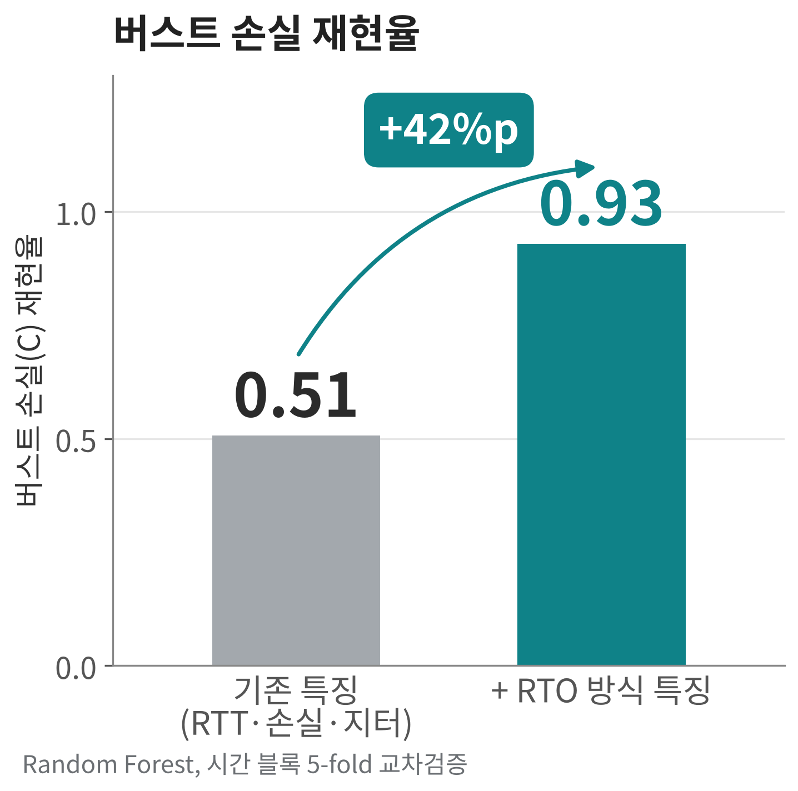
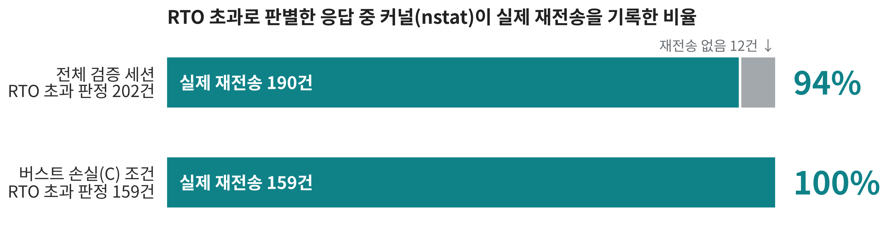
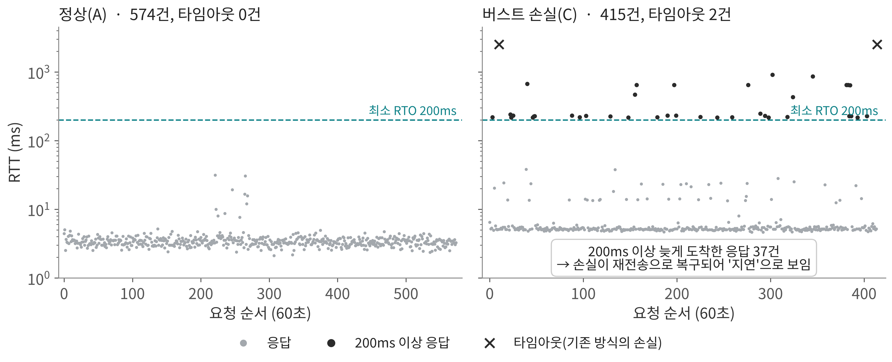
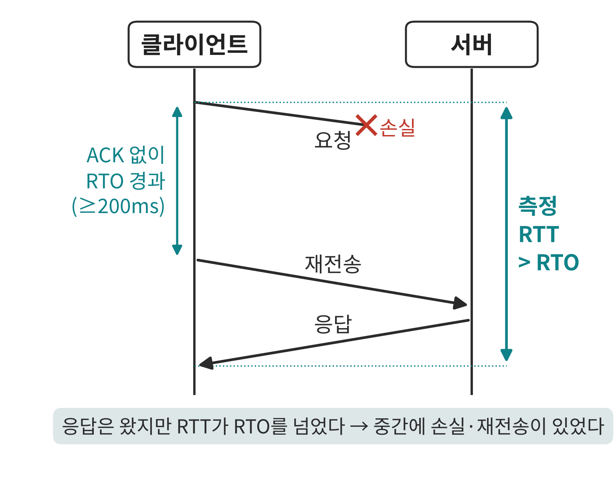
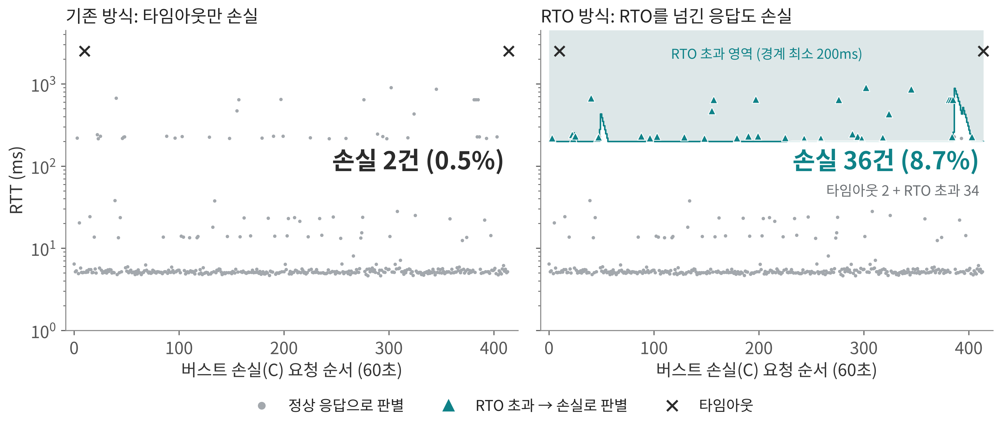

# Net_Guardian

**TCP 재전송 타이머를 이용한 Modbus TCP 제어망의 지연·버스트 손실 장애 판별**
*Delay and Burst Loss Fault Identification in Modbus TCP Control Networks Using the TCP Retransmission Timer*

패킷 내용을 열어보지 않고 **RTT, 손실 여부, 지터** 같은 가벼운 지표만으로 Modbus TCP 제어망의 장애 원인을 판별합니다.
특히 버스트 손실이 TCP 재전송으로 복구되면서 "지연"처럼 보이는 문제를 **TCP 재전송 타이머(RTO) 계산 방식**으로 구분합니다.

> 2026년도 한국멀티미디어학회 추계학술발표대회 논문집 제29권 2호
> 전재우, 김구민, 김승현, 이성근 · 국립순천대학교 인공지능공학부

---

## 핵심 결과

| 항목 | 결과 | 근거 파일 |
|---|---|---|
| 지연(B) 재현율 | **0.99 이상** | `backend/results_tcp_features/feature_comparison.csv` |
| 버스트 손실(C) 재현율 | **0.51 → 0.93** (+42%p, RTO 방식 특징 추가) | 같은 파일 (`karn`, `time_block_5fold`) |
| RTO 초과 판정의 정확도 | 판정 202건 중 **190건(94%)** 이 실제 TCP 재전송, 버스트 손실 조건에서는 **159건 모두** | `backend/results_tcp_features/verify_rto_vs_retrans.csv` |
| 60초 버스트 손실 구간의 손실 판별 | 기존 방식 2건 → RTO 방식 **36건(8.7%)** (설정 평균 손실률 약 8.2%) | `backend/results_tcp_features/rto_exceed_vs_retrans.csv` |
| 학습하지 않은 장애 강도 (Macro F1) | 0.549 → 다양한 강도 추가 학습 후 0.743 | `backend/results_tcp_features/more_training.csv` |

모든 수치의 출처와 계산 과정은 [`backend/docs/논문_수치근거_QnA.md`](backend/docs/논문_수치근거_QnA.md)와 [`backend/docs/논문_수치_검증_체크리스트.md`](backend/docs/논문_수치_검증_체크리스트.md)에 정리되어 있습니다.

<p align="center">
  
  
</p>

---

## 문제: 손실이 지연처럼 보인다

Modbus TCP는 TCP 위에서 동작하므로, 패킷이 손실되어도 TCP가 자동으로 재전송합니다.
그래서 응답은 결국 도착하고, 수집기에는 **타임아웃(손실)이 아니라 200ms 이상 늦은 응답(지연)** 으로 기록됩니다.

60초 동안의 버스트 손실(C) 조건에서 타임아웃은 2건뿐이었지만, 200ms 넘게 늦게 도착한 응답은 37건이었습니다.



## 아이디어: RTT가 RTO를 넘었다면 재전송이 있었다

TCP는 RTO(Linux 최소 200ms) 안에 ACK가 오지 않으면 패킷을 다시 보냅니다.
따라서 측정한 RTT가 그 시점의 RTO를 넘었다면, 중간에 손실과 재전송이 있었다고 볼 수 있습니다.

<p align="center"></p>

요청마다 RFC 6298 방식으로 SRTT, RTTVAR, RTO를 계산하고, 응답이 RTO를 넘었는지를 특징으로 추가했습니다.
(최근 15개 응답 중 RTO 초과 비율, SRTT, RTTVAR — 구현: `backend/eval_tcp_features.py`의 `tcp_features()`)



## 검증: 커널 재전송 기록과 대조

RTO 초과 판정이 정말 재전송인지 확인하기 위해, 요청마다 리눅스 커널의 TCP 재전송 카운터(`/proc/net/snmp`의 `RetransSegs`)가 늘었는지 함께 기록한 검증 세션(10,988건)을 따로 수집했습니다.
RTO 초과로 판정한 응답의 94%가 실제 재전송이었고, 버스트 손실 조건에서는 100%였습니다.

---

## 시스템 구성

```
┌──────────────────────── 테스트베드 (Linux 호스트 1대) ────────────────────────┐
│  Modbus TCP 클라이언트  ⇄  루프백(lo) + tc netem 장애 주입  ⇄  Modbus TCP 서버  │
│  (RTT·손실 측정)          A 정상 · B 지연 · C 버스트 손실 · D 복합              │
└──────────────────────────────────────────────────────────────────────────────┘
          │ RTT, 손실 여부, 라벨
          ▼
   특징 생성 (기본 · 윈도우 · RTO 방식)  →  Random Forest 장애 판별
          │                                         │
          ▼                                         ▼
   FastAPI 서빙 (/predict, /scenario,        성능 검증 (시간 블록 5-fold,
   /telemetry/latest)  →  Next.js 대시보드    독립 세션 3개, nstat 재전송 대조)
```

### 장애 시나리오

| 구분 | tc netem 설정 | 학습 데이터 건수 |
|---|---|---|
| A 정상 | 지연 1ms | 16,345 |
| B 지연 | 지연 120 ± 40ms | 1,759 |
| C 버스트 손실 | 지연 2ms + Gilbert-Elliott 손실 (p=5%, r=50%, 불량 상태 손실 90%) | 3,521 |
| D 복합 장애 | 지연·손실·단절 4단계 혼합 | 1,248 |

시나리오는 A→B→A→C→A→D 순서로 반복하며 0.1초 간격으로 측정했습니다 (총 22,873건).

---

## 저장소 구조

```
net_guardian/
├── backend/
│   ├── network/                  # Modbus 서버, tc netem 장애 주입 스크립트 (Linux)
│   ├── packet_analyzer.py        # 실시간 RTT·손실 수집기
│   ├── api/main.py               # FastAPI 모델 서빙
│   ├── train_and_benchmark.py    # 4개 모델 학습·벤치마크
│   ├── eval_tcp_features.py      # RTO 방식 특징 비교 (논문 핵심 결과)
│   ├── eval_verify_retrans.py    # nstat 재전송 대조 검증
│   ├── eval_more_training.py     # 추가 세션·강도 학습 실험
│   ├── make_figures.py           # 논문 그림 (흑백)
│   ├── make_poster_figures.py    # README·포스터 그림 (컬러)
│   ├── raw_dataset_20260904/     # 학습 데이터 (A/B/C/D)
│   ├── raw_dataset_20261004/     # 재현성·일반화·60초 재전송 데이터
│   ├── raw_dataset_20261009/     # 요청 단위 재전송 검증 데이터
│   ├── results_tcp_features/     # 논문 수치 결과
│   ├── models/                   # 학습된 모델 (.pkl)
│   └── docs/                     # 환경 구축, 실행 방법, 수치 근거 문서
├── frontend/                     # Next.js 대시보드
└── docs/images/                  # README 그림
```

---

## 실행 방법

자세한 내용은 [`backend/docs/실행방법.md`](backend/docs/실행방법.md)와 [`backend/docs/환경구축.md`](backend/docs/환경구축.md)를 참고하세요. 아래 명령은 모두 `backend/` 안에서 실행합니다.

### 1. 설치

```bash
cd backend
python -m venv venv
source venv/bin/activate          # Windows: venv\Scripts\activate
pip install -r requirements.txt
```

### 2. 논문 결과 재현 (수집된 데이터 사용)

```bash
python eval_tcp_features.py       # 기본 vs RTO 방식 특징 비교 → results_tcp_features/feature_comparison.csv
python eval_verify_retrans.py     # RTO 초과 판정 vs 실제 재전송 → results_tcp_features/verify_*.csv
python eval_more_training.py      # 추가 학습 실험 → results_tcp_features/more_training.csv
python make_figures.py            # 논문 그림 → figures/
python make_poster_figures.py     # README·포스터 그림 → ../docs/images/
```

### 3. 새 데이터 수집 (Linux, root 권한 필요)

```bash
# 터미널 1: Modbus 서버 (netem으로 장애를 줄 때는 서버 쪽 장애 재현을 끈다)
NG_SERVER_FAULTS=0 python network/server.py

# 터미널 2: 수집기 (재전송 카운터까지 기록하려면 PA_LOG_RETRANS=1)
python packet_analyzer.py

# 터미널 3: 시나리오 A→B→A→C→A→D 자동 순환 + 라벨 기록
bash network/master_collector.sh
```

### 4. 대시보드

```bash
# backend/
uvicorn api.main:app --reload --port 8000     # API 문서: http://127.0.0.1:8000/docs

# frontend/
npm install
npm run dev                                   # http://localhost:3000
```

대시보드의 시나리오 버튼(A/B/C/D)으로 장애를 주입하고, RTT·AI 진단·대응 가이드가 3초마다 갱신되는 것을 확인할 수 있습니다.

---

## 한계와 후속 연구

- 실제 산업 현장이 아니라, Linux 호스트 한 대의 루프백에서 tc netem으로 만든 장애입니다.
- 버스트 손실 조건의 기본 지연(2ms)이 정상 조건(1ms)과 달라, 평균 RTT 특징에는 재전송 지연뿐 아니라 설정값 차이도 섞였을 수 있습니다. 다만 RTO 초과 판정의 정확도(94%)는 요청 단위로 커널 재전송 기록과 직접 대조한 값입니다.
- 학습하지 않은 장애 강도에서는 Macro F1이 0.549로 떨어졌고, 다양한 강도를 학습에 넣은 뒤 0.743으로 올랐습니다.
- 복합 장애(D)는 첫 구간이 정상과 구분되지 않아 판별이 어렵습니다.

후속 연구로 버스트 손실 조건의 기본 지연을 정상과 맞춘 재수집, 장애 강도 다양화, 실제 산업 제어망 트래픽 검증을 계획하고 있습니다.

---

## 참고문헌

1. K. Stouffer et al., "Guide to Operational Technology (OT) Security," NIST SP 800-82 Rev. 3, 2023.
2. M. Hoeve, "Detecting Intrusions in Encrypted Control Traffic," Proc. ACM SEGS '13, pp. 23–28, 2013.
3. E. N. Gilbert, "Capacity of a Burst-Noise Channel," Bell System Technical Journal, vol. 39, no. 5, pp. 1253–1265, 1960.
4. P. Sarolahti, A. Kuznetsov, "Congestion Control in Linux TCP," Proc. USENIX Annual Technical Conference, FREENIX Track, pp. 55–58, 2002.
5. V. Paxson, M. Allman, J. Chu, M. Sargent, "Computing TCP's Retransmission Timer," RFC 6298, IETF, 2011.

## Acknowledgment

본 연구는 2026년도 과학기술정보통신부 및 정보통신기획평가원의 SW중심대학사업 지원을 받아 수행되었음 (2023-0-00028).
