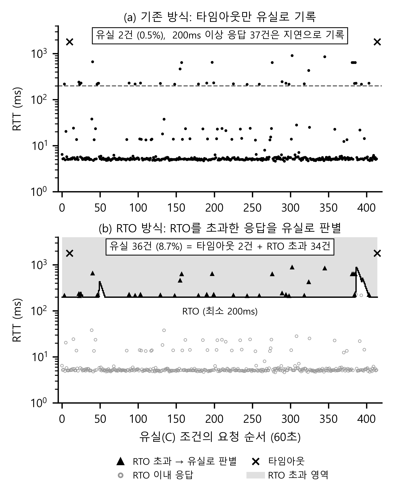

# RTO 비교 그림 해석 — 유실(C) 장애 설정과 그래프 읽는 법

- 그림: `backend/figures/fig_rto_compare_bw.png` (생성: `backend/make_figures.py`의 `rto_compare()`)
- 데이터: `backend/raw_dataset_20261004/retrans_C.csv` (유실(C) 조건 60초 고정 측정, 415건)
- 장애 주입 스크립트: `backend/network/master_collector.sh`

---

## 1. 스크립트 설정

```bash
sudo tc qdisc add dev lo root netem delay 2ms loss gemodel 5% 50% 90% 0%
sleep 30
sudo tc qdisc del dev lo root
```

| 부분 | 의미 |
|---|---|
| `dev lo` | 루프백 장치에 장애를 넣습니다. 클라이언트와 서버가 같은 호스트에 있어 모든 패킷이 lo를 지나갑니다. **요청, 응답, ACK가 모두 영향을 받습니다.** |
| `delay 2ms` | 패킷마다 2ms 지연입니다. 갈 때와 올 때 두 번 적용되어 기본 RTT는 약 5ms가 됩니다. 정상(A)은 `delay 1ms`라 약 3ms입니다. |
| `loss gemodel 5% 50% 90% 0%` | Gilbert-Elliott 손실 모델입니다. 아래 표 참고. |
| `sleep 30` → `del` | 30초 동안 유지한 뒤 장애를 해제합니다. 학습 데이터는 이 루프를 반복해 수집했고, 그래프의 60초 측정은 이 설정을 60초 동안 고정한 것입니다. |

### gemodel 네 값의 뜻

| 값 | 의미 |
|---|---|
| 5% (p) | 좋은 상태에서 나쁜 상태로 넘어갈 확률 (패킷마다) |
| 50% (r) | 나쁜 상태에서 좋은 상태로 돌아올 확률, 즉 나쁜 상태가 평균 2패킷 유지됨 |
| 90% (1−h) | 나쁜 상태일 때 패킷 손실 확률 |
| 0% (1−k) | 좋은 상태일 때 패킷 손실 확률 |

평균 손실률은 나쁜 상태 비율 5/(5+50) ≈ 9.1%에 90%를 곱해 **약 8.2%**입니다. 손실이 한 번에 몰려서(평균 2패킷) 일어나는 **버스트 손실**을 재현하는 설정입니다.

> ⚠️ 스크립트의 `echo "... (라벨 1)"`은 이전 이진 분류 시절의 문구입니다. 실제 라벨은 `set_scenario "C"`로 기록되고, 데이터에서는 C = 2입니다. 논문이나 발표에서 "라벨 1"이라고 쓰지 않도록 주의하세요.

---

## 2. 그래프 해석



위 그림은 1장의 설정(`delay 2ms loss gemodel 5% 50% 90% 0%`)을 60초 동안 고정하고 측정한 **같은 415건의 데이터**를 두 방식으로 본 것입니다. 점의 위치(RTT)는 위아래가 똑같고, **무엇을 유실로 세느냐만 다릅니다.**

| | (a) 기존 방식 | (b) RTO 방식 |
|---|---|---|
| 유실로 세는 것 | 타임아웃(×)만 | 타임아웃(×) + RTO를 초과한 응답(▲) |
| 200ms 이상 응답 | 응답이 왔으므로 **지연**으로 기록 | RTO 선 위에 있으면 **재전송 = 유실**로 판별 |
| 유실 건수 | 2건 (0.5%) | 36건 (8.7%) = 타임아웃 2 + RTO 초과 34 |

즉 GE 모델로 넣은 손실(평균 약 8.2%)은 대부분 TCP 재전송으로 복구되어 (a)에서는 200ms 이상의 **지연**처럼 보입니다. (b)처럼 RTO 기준을 적용하면 그 응답들을 **유실**로 다시 구별할 수 있습니다.

### 각 요소 읽는 법

- **x축:** 60초 동안의 요청 순서입니다(415건, 약 0.14초에 한 번).
- **y축:** 요청 하나의 응답 시간(RTT)입니다. 로그 눈금이라 위로 한 칸이 10배입니다.

| 높이 | 표시 | 의미 |
|---|---|---|
| **약 5ms 띠** | 회색 동그라미 | 손실 없이 바로 응답한 요청입니다. 대부분이 여기에 있습니다. |
| **약 13~40ms** | 회색 동그라미 | 조금 늦은 응답입니다. RTO까지 기다리지 않고 더 빨리 복구된 경우(빠른 재전송 등)로 **추정**합니다. 검증 세션에서도 RTO 방식이 놓친 재전송의 RTT 중간값이 34ms였습니다. RTO 방식으로는 잡히지 않는 부분입니다. |
| **약 200~230ms** | ▲ | **패킷이 한 번 손실되고 RTO(200ms)가 지난 뒤 재전송되어 도착한 응답입니다.** 그래서 200ms 바로 위에 몰려 있습니다. |
| **약 430~900ms** | ▲ | 재전송도 다시 손실되면 RTO가 늘어나(지수 백오프) 더 늦게 도착합니다. 몇 번 손실되었는지까지는 확정할 수 없습니다. |
| **맨 위** | × | 1초 안에 응답이 없어 **타임아웃**으로 기록된 요청입니다. 기존 방식은 이 2건만 유실로 셉니다. |

### 검은 실선 (RTO 선)

- 커널의 실제 RTO가 아니라, **측정한 RTT로 우리가 계산한 RTO**입니다. 계산식은 RFC 6298의 max(200ms, SRTT + 4·RTTVAR)입니다.
- 평소에는 RTT가 5ms 수준이라 계산값이 200ms보다 작고, 그래서 **200ms 바닥에 붙어 있습니다.**
- 요청 약 50번과 385번 근처에서 선이 솟는 것은 늦은 응답이 **연달아** 나왔기 때문입니다. 이때는 그 값을 평균에 반영해 RTO가 커졌다가 다시 줄어듭니다. 한 번만 튄 응답은 평균에서 빼서(Karn 방식) 선이 움직이지 않습니다.
- 선이 솟은 구간에서는 200ms 위에 있는데도 회색인 점이 있습니다. 그 시점의 RTO보다 낮아서 초과로 보지 않은 것입니다.

### 회색 영역과 판별 규칙

**응답이 RTO 선 위(회색 영역)에 들어가면 "재전송이 있었다 = 유실"로 판별합니다.** 판별된 응답 34건과 타임아웃 2건을 합쳐 유실 36건(8.7%)입니다.

---

## 3. 해석할 때 주의할 점

1. **8.7%와 8.2%는 단위가 다릅니다.** 8.2%는 패킷 하나 기준의 손실률이고, 8.7%는 요청 하나 기준입니다. 요청 하나에는 요청, 응답, ACK 등 여러 세그먼트(약 6.5개)가 오가고, ACK만 손실되면 응답이 늦어지지 않을 수도 있습니다. 그래서 "같다"가 아니라 **"비슷한 수준"**으로 써야 합니다.
2. **RTO 방식이 모든 손실을 찾는 것은 아닙니다.** 13~40ms 띠처럼 RTO 전에 복구된 손실은 놓칩니다. 대신 **잡은 것은 거의 확실히 재전송**입니다(검증 세션에서 94%, 유실 조건에서는 100%).
3. **정상(A)과 유실(C)의 기본 RTT 차이(약 3ms 대 5ms)는 손실 때문이 아닙니다.** 설정한 `delay`가 1ms와 2ms로 달라서 생긴 차이입니다.
