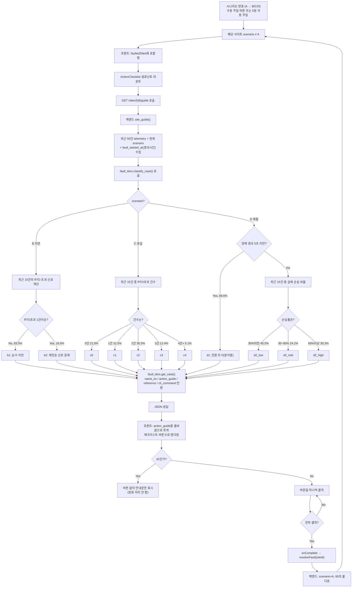

# 대응가이드 추천 알고리즘 — 흐름도와 상세 설명

## 0. 먼저 구분해야 할 것 — 이 대시보드엔 "판단 로직"이 2개 있다

| | ① 실시간 분류기 (화면 상단 배지/그래프 색) | ② 대응가이드 추천 (체크리스트) |
|---|---|---|
| 무엇인가 | `models/rf_best_accuracy.pkl` — 학습된 Random Forest | `backend/fault_tiers.py` — 학습 안 된 규칙 기반 알고리즘 |
| 입력 | 그 순간 샘플 1건의 rtt/loss_flag/jitter | 최근 50건 telemetry + 실제 주입된 시나리오(ground truth) + 장애 경과시간 |
| 출력 | 정상/지연/유실/복합 중 1개 + 확률 | 11가지 세부 사례 중 1개 (가이드 문구 포함) |
| 성격 | 기계학습(사전 학습된 모델) | TCP 재전송 타이머(RFC 6298) 계산 — "AI"라기보다 **결정론적 신호처리 규칙** |

이번에 질문하신 "AI로 대응가이드를 추천"은 **②번**입니다. ①번(진짜 ML 모델)은 화면 배지에만 쓰이고, 체크리스트 선택에는 **관여하지 않습니다** (전에 "AI 순간예측은 유실/복합에서 깜빡여서 체크리스트 기준으로 쓰면 안 된다"고 결론 내렸던 바로 그 이유 때문입니다). ②번은 엄밀히 말하면 "학습된 AI"가 아니라, **논문의 TCP RTO 방식을 그대로 가져온 규칙 기반 알고리즘**입니다.

---

## 1. 전체 흐름 (트리거 → 추천 → 완료까지)



---

## 2. "AI(규칙 기반 알고리즘)"가 실제로 어떻게 판단하는지

### 2-1. 핵심 아이디어 — TCP 재전송 기준시간(RTO)

TCP는 "응답이 이만큼 늦으면 패킷이 사라진 걸로 보고 재전송한다"는 기준시간을 계산해서 씁니다 (RFC 6298).

```
RTO = max(200ms, SRTT + 4 × RTTVAR)
```

- **SRTT**: 평활화된 평균 RTT (최근 응답들의 가중 이동평균)
- **RTTVAR**: RTT가 얼마나 들쭉날쭉한지(변동폭)
- 응답이 이 RTO보다 늦게 왔는데 **손실로 기록되진 않았다면**("응답은 왔지만 늦게 왔다") → "재전송이 숨어있었을 것"으로 간주 (`exceed = True`)

**직관적으로**: 지연(B)은 "평균 자체가 쭉 늦어지는 것"이고, 유실(C)은 "가끔 RTO를 훌쩍 넘겨서 온다"는 패턴 차이가 있습니다. 그래서 같은 RTT 수치라도 이 차이를 보면 지연인지 유실인지 구분할 수 있습니다 — 이게 논문이 "유실이 지연처럼 보이는 문제"를 푼 방법입니다.

### 2-2. Karn 알고리즘 — 갑자기 튄 값은 평균 계산에서 제외

문제: 재전송으로 보이는 샘플(`exceed=True`) 자체를 SRTT 계산에 넣으면, 평균이 같이 튀어서 다음 샘플도 또 `exceed`로 잘못 판정되는 악순환이 생깁니다. 그래서:

```python
if exceed and not prev_exceed:   # 방금 처음 튄 경우
    update = False                # 이번 샘플은 SRTT/RTTVAR 계산에서 제외
```

즉 "방금 갑자기 늦게 온 샘플"은 평균을 더럽히지 않게 빼고, 그 다음에도 계속 늦으면("연속으로 느림") 그건 "진짜 지연"으로 보고 반영합니다. 이게 `backend/fault_tiers.py`의 `_tcp_rto_features()` 함수 내용 그대로입니다.

### 2-3. 최근 15건 중 몇 건이 초과했는지 — 이게 최종 판단 기준

위 계산을 샘플 하나하나 순서대로 돌리면서, 매 시점마다 "최근 15건 중 RTO를 초과한 비율"을 추적합니다. 이 비율 하나로 유형별 판단 기준이 전부 결정됩니다:

| 시나리오 | 보는 값 | 판단 |
|---|---|---|
| 지연(B) | 15건 중 1건 이상 초과? | 0건=`b1`(순수), 1건+=`b2`(재전송혼재) |
| 유실(C) | 15건 중 초과 건수(0~4+) | 그대로 `c0`~`c4` |
| 복합(D) | (RTO초과 대신) 15건 중 실제 손실 건수 | `d2_low`/`d2_mid`/`d2_high` |

**복합(D)만 왜 다른 값(손실률)을 쓰는지**: D의 실제 장애 구간은 거의 전부 "응답 자체가 없음"(loss_flag=1)이라서, RTO초과 피처는 손실이 아닌 샘플(`loss==0`)에만 적용되는 조건이라 D에서는 항상 0으로 나옵니다. 그래서 D는 대신 "최근 15건 중 실제로 몇 건이 손실이었는지"를 봅니다.

### 2-4. 장애 경과시간 — 복합(D)에만 추가로 필요한 정보

복합 장애는 실제 데이터를 보면 **장애로 전환된 직후 5초간은 아직 정상 설정이 남아있는 과도구간**이라는 게 확인됐습니다(전체의 69.6%). 그래서 D는 RTO/손실률을 보기 전에 먼저 "언제 장애가 시작됐는지"를 확인합니다 — 이건 백엔드가 `_site_runtime[site_id]["fault_started_at"]`에 장애 주입 시각을 기록해뒀다가, 지금 시각과의 차이로 계산합니다.

### 2-5. 최종적으로 가이드가 만들어지는 과정

1. 위 과정으로 사례 ID(예: `c2`)가 결정됨
2. `fault_tiers.CASES["c2"]`에서 미리 정의된 `{name_ko, action_guide, reference, cli_command}`를 그대로 꺼내옴 — **여기서부터는 AI가 새로 글을 쓰는 게 아니라, 미리 작성해둔 11가지 문구 중 하나를 "골라서" 보여주는 것**입니다
3. `action_guide`(줄바꿈으로 구분된 1~4개 문장)를 프론트가 쪼개서 체크리스트 버튼으로 표시

**정리하면**: "AI가 대응가이드를 써준다"는 표현보다는, **"TCP 재전송 신호를 분석해서 11가지 미리 정의된 가이드 중 지금 상황에 가장 맞는 걸 고르는 규칙 기반 알고리즘"**이 더 정확한 설명입니다. 조원분들께 설명하실 때 이 표현을 쓰시는 게 나중에 "AI가 뭘 학습했냐"는 질문을 받았을 때 오해를 피할 수 있습니다.
